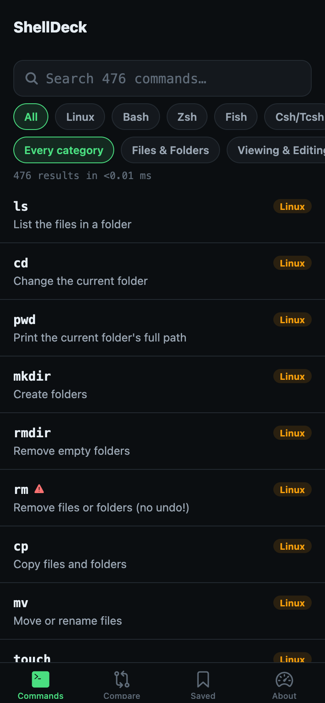
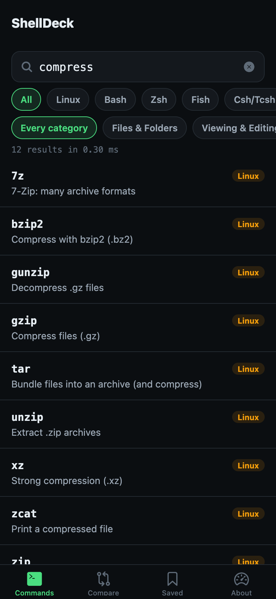
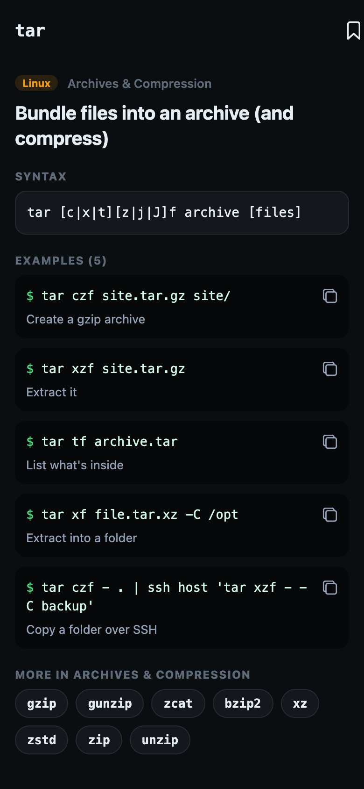
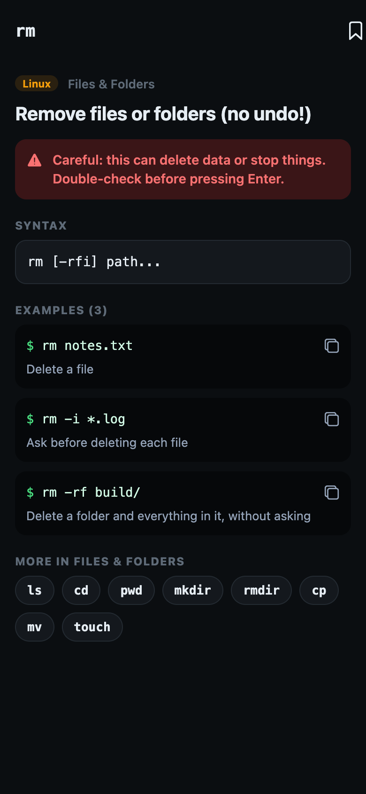
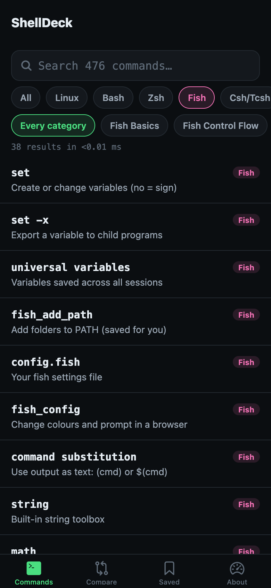
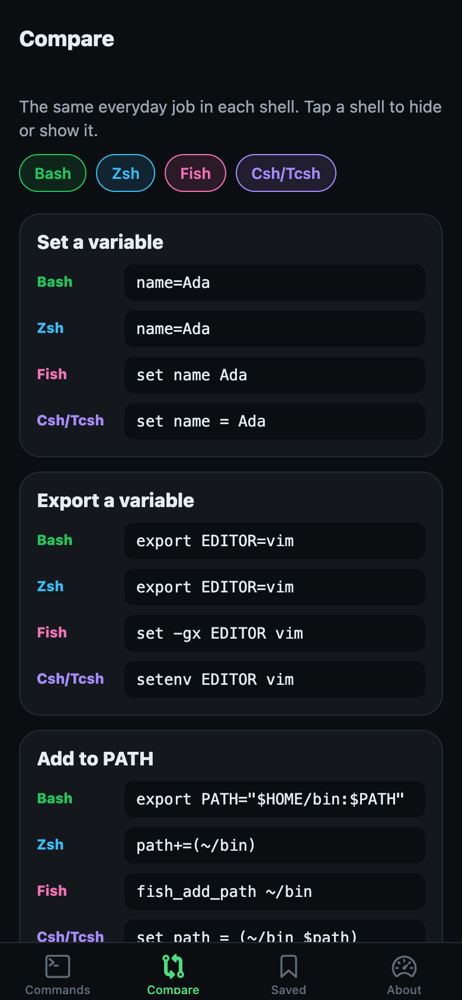
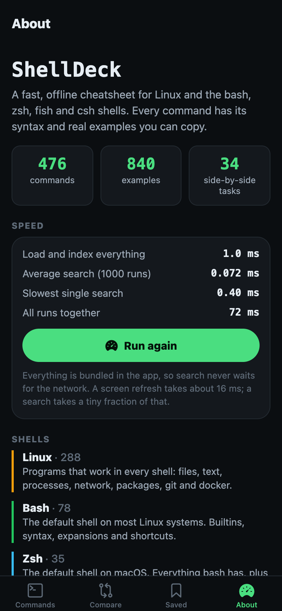
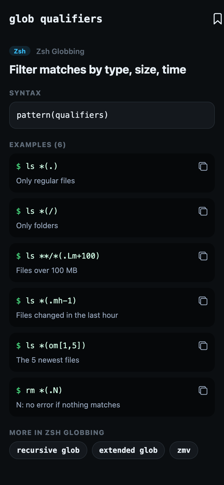
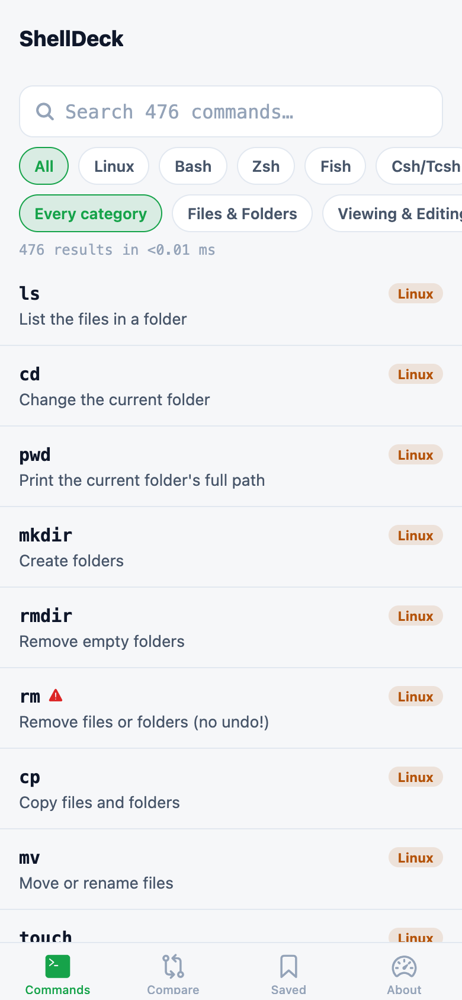

<div align="center">



# ShellDeck

**A fast, offline command cheatsheet for Linux, bash, zsh, fish and csh.**

476 commands and 840 copy-ready examples, with instant search, shell filters and a side-by-side comparison of how each shell does the same job.


</div>

---

## Screenshots

<table>
  <tr>
    <td align="center"><br><sub><b>476 commands</b></sub></td>
    <td align="center"><br><sub><b>Instant search</b></sub></td>
    <td align="center"><br><sub><b>Syntax and copyable examples</b></sub></td>
  </tr>
  <tr>
    <td align="center"><br><sub><b>Warnings on dangerous commands</b></sub></td>
    <td align="center"><br><sub><b>Filter by shell</b></sub></td>
    <td align="center"><br><sub><b>Compare shells side by side</b></sub></td>
  </tr>
  <tr>
    <td align="center"><br><sub><b>Built-in speed test</b></sub></td>
    <td align="center"><br><sub><b>Shell-specific features</b></sub></td>
    <td align="center"><br><sub><b>Light mode</b></sub></td>
  </tr>
</table>

## What's inside

| Shell | Commands | Covers |
|---|---|---|
| **Linux** | 288 | Files, text, search, permissions, users, processes, system info, disks, archives, networking, packages, services, Git, Docker, terminal tools, kernel |
| **Bash** | 78 | Variables, quoting and expansion, redirection, control flow, functions and scripts, jobs and history, keyboard shortcuts |
| **Zsh** | 35 | Setup and options, recursive globbing and glob qualifiers, 1-based arrays and parameter flags, zsh-only tricks |
| **Fish** | 38 | `set` variables, control flow, functions and abbreviations, autosuggestions and history |
| **Csh/Tcsh** | 37 | `set`/`setenv`, `@` arithmetic, variable modifiers, `foreach`, csh redirection |

Plus **34 everyday tasks compared across bash, zsh, fish and csh**: setting variables, PATH, loops, functions, string tricks, redirection and more.

## Features

- ⚡ **Instant search** that ranks by command name, then by what the command does ("disk space" finds `df` and `du`)
- 🐚 **Filter by shell and category**
- 📋 **Copy any example** with one tap (with haptic feedback)
- ⚠️ **Warnings** on commands that can delete data or stop a system (`rm -rf`, `dd`, `mkfs`…)
- 🔖 **Saved commands** and recently viewed, kept on your phone
- 🔀 **Compare tab**: the same job in four shells
- 🌗 **Dark terminal theme** with light mode
- ✈️ **Fully offline**: everything is bundled in the app

## How fast is it?

The About tab has a speed test you can run on your own phone. In a browser on a MacBook:

| | Time |
|---|---|
| Load and index all 476 commands at startup | ~1 ms |
| Average search | **0.075 ms** |
| Slowest single search | 0.3 ms |

One screen refresh takes about 16 ms, so a search costs well under 1% of a frame. How:

- Commands are written in a compact text format (`name :: summary :: syntax`, with indented examples) and parsed once at startup into objects with **pre-lowercased search fields**.
- Search is a single scan with early exit: every word must match, and name matches score higher than description matches.
- The list uses **fixed-height rows** (`getItemLayout`), memoised rows and `useDeferredValue`, so typing stays smooth while results update.

## Project structure

```text
src/
├── app/                    # Expo Router screens
│   ├── (tabs)/             # Commands, Compare, Saved, About
│   └── command/[id].tsx    # Command detail
├── data/
│   ├── sheets/             # The commands, one plain-text sheet per shell
│   ├── commands.ts         # Sheet parser + index
│   └── compare.ts          # Side-by-side shell table
├── lib/search.ts           # Ranking search
├── state/store.tsx         # Saved + recent (AsyncStorage)
└── components/ui.tsx       # Rows, chips, code lines
__tests__/                  # Data checks, search speed, and full app flows
```

### Adding a command

Add it to the right sheet in `src/data/sheets/`:

```text
## Networking
ping :: Check if a host is reachable :: ping [-c N] host
  ping -c 4 google.com :: Send 4 pings, then stop
```

Add ` :: !` after the syntax to mark a command as dangerous. The tests check that every command has a summary, syntax and at least one example, and that ids are unique.

## Getting started

```bash
git clone https://github.com/tejHacks/shelldeck.git
cd shelldeck
npm install
npx expo start        # scan the QR code with Expo Go, or press i / a
```

```bash
npm test              # 19 tests: data, search speed, app flows
npm run typecheck
npx expo lint
```

## Roadmap

- [ ] Android and iOS store builds
- [ ] More shells: PowerShell and nushell
- [ ] "Explain this command": paste a command and see each part explained
- [ ] Home-screen widget with a command of the day

## Author

**Olateju Olamide Emmanuel**: mobile developer (Flutter · React Native · Swift · Laravel)

- GitHub: [@tejHacks](https://github.com/tejHacks)

If ShellDeck saved you a trip to the man pages, please ⭐ the repo!
